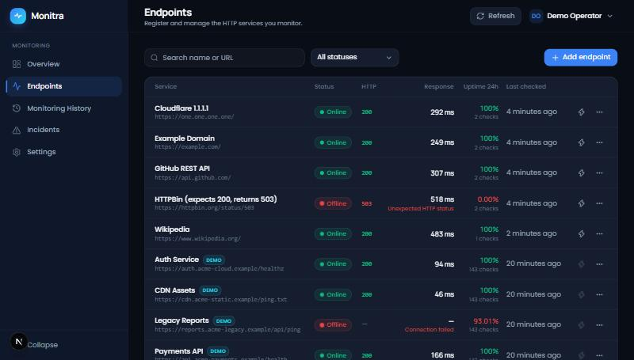
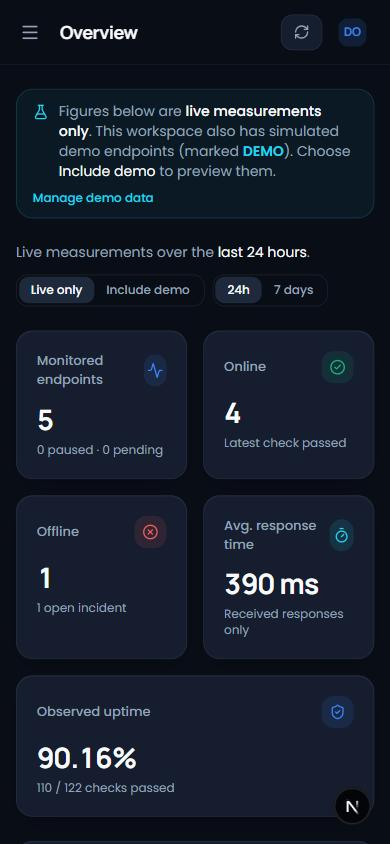

# Monitra

**Monitor your infrastructure. Stay in control.**

Monitra is an open-source infrastructure and API monitoring platform. Register HTTP/HTTPS services, and Monitra checks them on a schedule, records every status code and response time, opens incidents when a healthy service starts failing, and resolves them when it recovers. Everything shows up in a dark-first dashboard.

It is built as a monorepo: a **Laravel 13** REST API (`apps/api`) and a **Next.js 15** dashboard (`apps/web`).

---

## Contents

- [Features](#features)
- [Technology stack](#technology-stack)
- [Architecture](#architecture)
- [Installation (Laragon / Windows)](#installation-laragon--windows)
- [Environment variables](#environment-variables)
- [Running the application](#running-the-application)
- [Running tests](#running-tests)
- [API overview](#api-overview)
- [Security considerations](#security-considerations)
- [Demo data](#demo-data)
- [Screenshots](#screenshots)
- [Roadmap](#roadmap)

---

## Features

- **Real HTTP/HTTPS health checks** run by Laravel's HTTP client: status code, response time, success/failure and a sanitised error category for every check.
- **SSRF-hardened checker.** Only public destinations are allowed, the connection is pinned to a validated IP, redirects are disabled, and response size, timeouts, ports and protocols are all limited.
- **Scheduler** (`monitra:check-due`) with per-endpoint intervals (1 min to 1 h), batching, overlap protection and bounded (sequential) concurrency.
- **Incident lifecycle:** an incident opens on healthy → unhealthy and resolves on recovery. The database guarantees at most one open incident per endpoint.
- **Endpoint management:** create, edit, pause/resume, delete, and run a rate-limited manual check.
- **Dashboard:** KPIs (total, online, offline, average response time, observed uptime), response-time and activity charts, status distribution, and recent incidents.
- **Monitoring history:** server-side paginated check log with endpoint, result and time-range filters, plus historical charts.
- **Incidents page** with state and endpoint filters, start and resolve times, and durations.
- **Session authentication** with Laravel Sanctum (cookie-based SPA auth, CSRF protection, ownership checks on every resource).
- **Clearly separated demo data:** simulated endpoints are flagged and labelled "Demo" and are never mixed with live measurements.
- **Responsive UI:** a collapsible sidebar on desktop, a navigation sheet on mobile, and tables that become cards on small screens.

> Uptime figures are **observed, check-based availability**: successful checks divided by recorded checks. They are computed only from persisted results. When nothing was recorded, Monitra shows "—" rather than 100%.

## Technology stack

| Layer | Technology |
| --- | --- |
| Backend | PHP 8.3, Laravel 13, Eloquent, Laravel HTTP Client (Guzzle/cURL), Laravel Scheduler, Sanctum |
| Database | MySQL 8 (SQLite in-memory for tests) |
| Frontend | Next.js 15 (App Router), React 19, TypeScript (strict), Tailwind CSS 4, shadcn/ui (Base UI), Lucide, Recharts, SWR, React Hook Form + Zod |
| Typography | Poppins (interface text) and Manrope (headings and metrics), loaded with `next/font/google` |
| Quality | PHPUnit 12, Laravel Pint, ESLint, `tsc --noEmit`, GitHub Actions |

## Architecture

```
monitra/
├── apps/
│   ├── api/                     Laravel REST API
│   │   ├── app/
│   │   │   ├── Console/Commands/    monitra:check-due, monitra:create-user
│   │   │   ├── Enums/               EndpointStatus, IncidentState, CheckErrorCategory
│   │   │   ├── Http/Controllers/Api Thin controllers
│   │   │   ├── Http/Requests/       Form request validation
│   │   │   ├── Http/Resources/      API response formatting
│   │   │   ├── Models/              User, Endpoint, CheckResult, Incident
│   │   │   ├── Policies/            EndpointPolicy (ownership)
│   │   │   ├── Rules/               PublicHttpUrl
│   │   │   └── Services/
│   │   │       ├── Monitoring/      DestinationGuard, HttpChecker, MonitoringService
│   │   │       └── MetricsService   Dashboard and endpoint aggregations
│   │   ├── database/                Migrations, factories, DemoSeeder
│   │   └── tests/Feature/           Auth, CRUD, SSRF, monitoring, dashboard
│   └── web/                     Next.js dashboard
│       └── src/
│           ├── app/                 Routes: /login, /overview, /endpoints, /history, /incidents, /settings
│           ├── components/          layout, charts, endpoints, incidents, history, common, ui (shadcn)
│           ├── hooks/               SWR data hooks with polling
│           └── lib/api/             Typed API client, contracts, services
├── docs/                        Architecture and API documentation
└── .github/workflows/ci.yml     Continuous integration
```

Request flow for a check: `Scheduler → monitra:check-due → MonitoringService → HttpChecker → DestinationGuard (validate + resolve) → pinned cURL request → persist result + incident transition (one DB transaction)`.

See [`docs/architecture.md`](docs/architecture.md) for design decisions and [`docs/api.md`](docs/api.md) for the full API reference.

## Installation (Laragon / Windows)

Prerequisites (verified with): PHP 8.3, Composer 2.9, Node.js 22, npm 10, MySQL 8 and Git. Laragon provides all of them. If `php` is not on your PATH, use Laragon's terminal (Cmder), or add `C:\laragon\bin\php\php-8.3.x\` to PATH.

Clone this repository with Git, using the HTTPS or SSH URL from the green **Code** button on its GitHub page, or with GitHub Desktop (**Code → Open with GitHub Desktop**). Clone it into Laragon's web root, for example `C:\laragon\www\monitra`, then open a terminal in the project folder:

```bash
cd monitra
```

### 1. Database

Create an empty MySQL database named `monitra`, for example from HeidiSQL or phpMyAdmin in Laragon:

```sql
CREATE DATABASE monitra CHARACTER SET utf8mb4 COLLATE utf8mb4_unicode_ci;
```

### 2. Backend (`apps/api`)

```bash
cd apps/api
composer install
cp .env.example .env
php artisan key:generate
```

Edit `.env` to match your Laragon MySQL credentials. Laragon's default is `root` with an empty password, but check yours. Then set a local demo password:

```dotenv
DB_DATABASE=monitra
DB_USERNAME=root
DB_PASSWORD=
DEMO_USER_PASSWORD=choose-a-local-password
```

Run migrations and seed the demo workspace:

```bash
php artisan migrate --seed
```

To create your own account instead of (or alongside) the demo account:

```bash
php artisan monitra:create-user --name="Jane Doe" --email=jane@example.com
```

### 3. Frontend (`apps/web`)

```bash
cd apps/web
npm install
cp .env.example .env.local
```

`NEXT_PUBLIC_API_URL` defaults to `http://localhost:8000`. **Use `localhost` for both apps, not `127.0.0.1`**, so the session and XSRF cookies are shared.

## Environment variables

### `apps/api/.env`

| Variable | Default | Purpose |
| --- | --- | --- |
| `APP_URL` | `http://localhost:8000` | API origin |
| `DB_*` | `mysql` / `monitra` / `root` | MySQL connection |
| `FRONTEND_URL` | `http://localhost:3000` | Allowed CORS origin(s), comma-separated |
| `SANCTUM_STATEFUL_DOMAINS` | `localhost:3000,127.0.0.1:3000` | Hosts that receive cookie-based session auth |
| `SESSION_DRIVER` / `SESSION_ENCRYPT` | `database` / `true` | Encrypted server-side sessions |
| `SESSION_SECURE_COOKIE` | `false` | Set to `true` behind HTTPS in production |
| `MONITRA_CONNECT_TIMEOUT` | `5` | Seconds to establish a connection |
| `MONITRA_REQUEST_TIMEOUT` | `10` | Total seconds per check |
| `MONITRA_MAX_RESPONSE_BYTES` | `1048576` | Abort checks whose body exceeds this size |
| `MONITRA_DNS_TIMEOUT` / `MONITRA_DNS_ATTEMPTS` | `2` / `2` | DNS lookup limit: seconds per attempt and attempts per nameserver (applied on glibc/Linux via `RES_OPTIONS`) |
| `MONITRA_ALLOWED_PORTS` | `80,443,8080,8443` | TCP ports that may be monitored |
| `MONITRA_SCHEDULER_BATCH_SIZE` | `50` | Maximum endpoints per scheduler run |
| `MONITRA_MAX_ENDPOINTS_PER_USER` | `50` | Live endpoints an account may register |
| `MONITRA_RETENTION_DAYS` | `90` | Days of check history kept by `monitra:prune-checks` |
| `DEMO_USER_EMAIL` / `DEMO_USER_PASSWORD` | `demo@monitra.test` / *(empty)* | Local demo account. An empty password generates a random one and prints it |

### `apps/web/.env.local`

| Variable | Default | Purpose |
| --- | --- | --- |
| `NEXT_PUBLIC_API_URL` | `http://localhost:8000` | Base URL of the Laravel API |

## Running the application

Run each process in its own terminal:

```bash
# 1. API: http://localhost:8000
cd apps/api
php artisan serve --host=localhost --port=8000
```

```bash
# 2. Scheduler: runs due checks every minute
cd apps/api
php artisan schedule:work
```

```bash
# 3. Dashboard: http://localhost:3000
cd apps/web
npm run dev
```

Open <http://localhost:3000> and sign in with `DEMO_USER_EMAIL` / `DEMO_USER_PASSWORD`.

> Checks only run while the scheduler is running. You can also trigger checks once with `php artisan monitra:check-due` or with **Check now** in the UI. On a server, add the standard cron entry: `* * * * * php /path/to/apps/api/artisan schedule:run`.

The scheduler also runs `monitra:prune-checks` daily at 03:15, deleting check results older than `MONITRA_RETENTION_DAYS`. Run it manually with `php artisan monitra:prune-checks [--days=N]`.

Production frontend build:

```bash
cd apps/web
npm run build
npm start
```

### Production checklist

The `.env.example` defaults are for **local development**. Before deploying the API, set at least:

```dotenv
APP_ENV=production
APP_DEBUG=false                 # never expose stack traces publicly
APP_URL=https://api.your-domain.com
FRONTEND_URL=https://monitra.your-domain.com
SANCTUM_STATEFUL_DOMAINS=monitra.your-domain.com
SESSION_DOMAIN=.your-domain.com  # shared parent domain of API and frontend
SESSION_SECURE_COOKIE=true      # HTTPS-only cookies
```

Then run `php artisan key:generate` (once), `php artisan migrate --force` and `php artisan config:cache`, and add the scheduler cron entry. Do **not** run `db:seed` in production: the demo seeder refuses to run outside `local`/`testing`. Create accounts with `php artisan monitra:create-user` instead.

## Running tests

```bash
# Backend: 79 PHPUnit tests (SQLite in-memory, no network or DNS access)
cd apps/api
php artisan test
vendor/bin/pint --test
```

```bash
# Frontend: type-check, lint and production build
cd apps/web
npx tsc --noEmit
npm run lint
npm run build
```

The backend suite covers authentication, authorisation (ownership checks returning 404), endpoint CRUD and validation, 33 SSRF bypass vectors, DNS-rebinding scenarios, transport pinning, check persistence, error categorisation, incident transitions, the one-open-incident DB constraint, scheduler selection, batching and drift-free intervals, dashboard aggregation with live/demo separation, the endpoint quota, retention pruning, and non-destructive demo re-seeding.

## API overview

All routes are JSON, under `/api`, and require an authenticated session except `POST /api/auth/login`.

| Method | Route | Description |
| --- | --- | --- |
| `GET` | `/sanctum/csrf-cookie` | Issue the XSRF-TOKEN cookie |
| `POST` | `/api/auth/login` | Start a session (rate limited) |
| `POST` | `/api/auth/logout` | End the session |
| `GET` | `/api/auth/user` | Current user |
| `GET` | `/api/dashboard?range=24h\|7d&source=live\|all` | KPIs, time series and recent incidents (`live`, the default, excludes simulated demo data) |
| `GET` | `/api/endpoints?search=&status=` | List endpoints with latest check and 24h stats |
| `POST` | `/api/endpoints` | Create an endpoint (limited to `MONITRA_MAX_ENDPOINTS_PER_USER`) |
| `GET` | `/api/endpoints/{id}` | Endpoint detail |
| `PUT`/`PATCH` | `/api/endpoints/{id}` | Update (PATCH allows partial, e.g. `is_enabled`) |
| `DELETE` | `/api/endpoints/{id}` | Delete with its history |
| `POST` | `/api/endpoints/{id}/check` | Run a manual check (10/min per user) |
| `GET` | `/api/endpoints/{id}/metrics?range=` | Endpoint time series and summary |
| `GET` | `/api/checks?endpoint_id=&status=&range=&source=&page=` | Paginated check history (`source=live` hides simulated rows) |
| `GET` | `/api/incidents?state=&endpoint_id=&page=` | Paginated incidents |
| `GET` | `/api/settings/monitoring` | Server-enforced monitoring policy |
| `DELETE` | `/api/settings/demo-data` | Remove the user's demo endpoints |

Full request and response details: [`docs/api.md`](docs/api.md).

## Security considerations

- **SSRF protection** (`app/Services/Monitoring/DestinationGuard.php`, `HttpChecker.php`):
  - Only `http`/`https`, no embedded credentials, only allowed ports, and only fully qualified hostnames. Numeric, hex and short IP encodings are rejected, as are internal suffixes such as `.local`, `.internal` and `localhost`.
  - Every DNS answer (A and AAAA) must be publicly routable. Loopback, private (RFC 1918), CGNAT, link-local (cloud metadata `169.254.169.254`), multicast, reserved, documentation, IPv6 ULA and link-local, IPv4-mapped, NAT64, 6to4 and Teredo ranges are all blocked. If *any* answer is private, the URL is rejected.
  - The request is **pinned to the validated IP** with `CURLOPT_RESOLVE`, so cURL never performs a second lookup. This defeats DNS rebinding between validation and connection. The connected IP is verified again afterwards.
  - Redirects are never followed, environment proxies are ignored, the response body is capped, and the only method is `GET`.
  - DNS lookups are time-bounded (`MONITRA_DNS_TIMEOUT` × `MONITRA_DNS_ATTEMPTS` per nameserver on glibc; other resolvers use OS defaults), so a slow resolver can't stall the scheduler indefinitely.
  - The guard runs on create and update (validation) **and** again on every check.
- **Authentication:** Sanctum SPA session cookies (HttpOnly, encrypted, `SameSite=Lax`), CSRF tokens on every mutation, session regeneration on login and invalidation on logout, and login rate limiting (5/min per email+IP).
- **Authorisation:** every endpoint, check and incident query is scoped to the owner. Foreign IDs return `404` to prevent enumeration, and history filters validate endpoint ownership.
- **CORS:** only `FRONTEND_URL` origins, with credentials. Preflight responses are cached for 2 hours.
- **Security headers:** the API sends `nosniff`, `X-Frame-Options: DENY`, `Referrer-Policy: no-referrer`, a deny-all CSP for its JSON responses, and HSTS over HTTPS. The dashboard sends `nosniff`, frame denial, a strict referrer policy, a restrictive `Permissions-Policy`, and a CSP limiting framing, plugins, `base-uri` and form targets. The dashboard is marked `noindex`.
- **Abuse limits:** at most `MONITRA_MAX_ENDPOINTS_PER_USER` live endpoints per account (default 50), and manual checks are limited to 10 per minute.
- **Safe errors:** raw exception messages, which can leak internal addresses, are never stored or returned. Checks store a sanitised category.
- **No public sign-up:** accounts are provisioned with `php artisan monitra:create-user`. The demo seeder refuses to run outside `local`/`testing`.
- **No secrets in Git:** `.env` files are ignored, and `.env.example` files contain no credentials.

## Demo data

`php artisan db:seed` creates a demo account with two kinds of endpoints:

- **Live endpoints** (`example.com`, `api.github.com`, `one.one.one.one`, and an `httpbin.org` URL that intentionally returns 503) with *no* seeded history. The scheduler checks them for real.
- **Demo endpoints** on reserved `.example` domains, which can never resolve, with 7 days of **simulated** history: realistic latency variation, resolved incidents, and one ongoing incident. They are flagged `is_demo`, every result is flagged `is_simulated`, they are labelled **DEMO** throughout the UI, and the scheduler and manual checks refuse to check them.

**Simulated data never mixes with live figures by default.** The Overview and History pages show live measurements only. A **Live only / Include demo** switch, shown only when demo data exists, lets you preview the simulated history, and the page then states that its figures include demo data.

The simulated history is generated relative to the moment you seed, so it ages over time. **Re-run `php artisan db:seed` at any time to refresh it.** Re-seeding is non-destructive: it replaces only the demo endpoints and their simulated history, keeps your own endpoints and their real checks, and adds the sample live endpoints only if they are missing. If `DEMO_USER_PASSWORD` is set, the demo account's password is synced to it; otherwise the existing password is kept.

Remove all demo data from **Settings → Demo data**. Monitra monitors HTTP/API availability only and does not collect CPU, RAM or disk metrics.

## Screenshots

| Endpoints | Overview (mobile) |
| --- | --- |
|  |  |

*Add full-resolution captures of the Overview, Endpoint detail and Incidents pages to `docs/screenshots/`.*

## Roadmap

- Notification channels (email, Slack, webhooks) on incident open/resolve
- Consecutive-failure thresholds and multi-region checks
- Keyword/JSON body assertions and TLS certificate expiry monitoring
- Concurrent checks via queue workers for large installations
- Public status pages
- Aggregated rollups for long ranges
- Team workspaces and roles

## License

[MIT](LICENSE)
